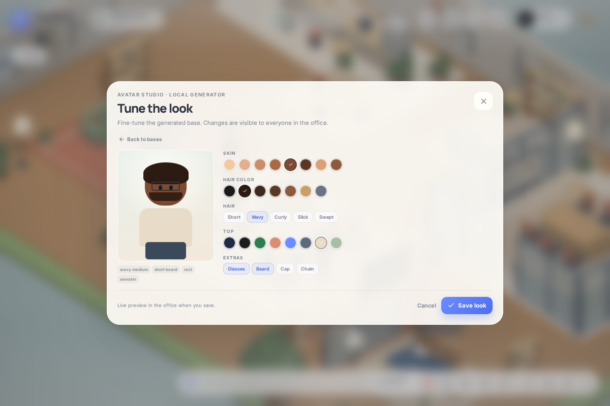
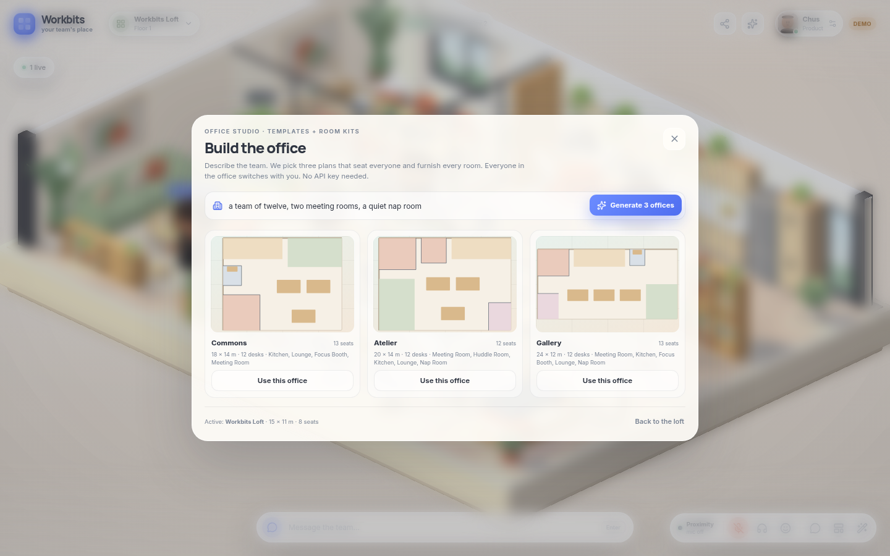

# Workbits

**A browser-based isometric virtual office where remote teams can see each other, walk over, talk by proximity, chat, and work.**

Workbits is built to be a product, not an internal tool: multi-tenant architecture, customizable offices, AI-assisted world-building, and a deployment story that starts with one Node process and scales without a rewrite.


| Avatar Studio | Office Studio |
|---|---|
|  |  |

## Status

**Working locally now:**

- **Buildable offices.** An office is a document (rooms, glass, furniture, spawns) that the server and client compile the same way. Six plans ship, from a 12 × 9 studio to a 24 × 12 gallery, and room kits furnish any room size. The Office studio turns a sentence ("a team of twelve, no nap room") into three plans; picking one switches the office for everyone.
- **Walls are real.** The server only accepts movement at walking speed along walkable ground; click-to-walk finds a path through doors, and the arrow keys slide along walls.
- **Presence and chat.** Colyseus realtime presence; Global, Office, Room and DM chat with unread indicators. Room chat follows the room you're in, DMs are routed server-side, and history persists.
- **Proximity voice** via LiveKit: server-minted tokens, distance-based volume, and a separate voice channel for every private room.
- **Avatar Studio:** prompt, three bases, tune skin, hair, outfit and accessories; your avatar syncs to everyone.
- **Office assistant:** ask where people are, which room is free, or for a summary. Answers come from live presence, with walk-to actions. No API key needed.
- **Demo cast** (8 characters including a frog and a winged crab), statuses, emotes, invite links, reconnect, mobile layout, a welcome page, and a single-process production mode.

**Not done yet:** auth, orgs and invites; persistence of offices; the office editor; a real LLM provider; billing; multi-instance scale.

**Known limitations:**

- **No auth.** Anyone connected can switch the office for everyone. Fine for local development; don't deploy it publicly yet.
- **Performance.** On a weak integrated GPU (Intel UHD, Ice Lake GT1) at 1080p the loft runs about 43 fps and 50 avatars about 33 fps (target 60). See `bun scripts/perf-check.mjs` and [`docs/verification/perf/`](docs/verification/perf/).
- Some art scripts expect private reference images that aren't in this repo (see [`art/README.md`](art/README.md)).

## Quick start

You need [Bun](https://bun.sh) 1.4+, Node 22+, and Docker (for the local LiveKit voice server).

```bash
bun install
bun run dev
```

`bun run dev` starts the self-hosted LiveKit container (via Docker Compose), the realtime server on `:3101`, and the web app on `:3100`.

### Production (single process)

The same Node process serves the built web app, the Colyseus realtime endpoint, and the LiveKit token API:

```bash
bun run build
bun run start
# http://localhost:3101
```

`bun run prod-check` builds, boots a production server on `:3201`, and verifies static serving, SPA fallback, health, token rejection, hashed assets, same-origin realtime, and a clean browser load.

### Docker

```bash
docker compose -f infra/docker-compose.prod.yml up --build
# http://localhost:3200
```

This starts the app container plus LiveKit. Set `LIVEKIT_URL`, `LIVEKIT_API_KEY`, and `LIVEKIT_API_SECRET` for anything beyond the local dev keys.

Open **http://localhost:3100**. The marketing page is at **http://localhost:3100/welcome.html**. In the app, click the user chip in the top-right to switch demo characters, or open a second tab with:

```
http://localhost:3100/?character=jules
```

Click the mic to publish your microphone. Voice volume follows avatar distance; private rooms (the meeting room, the nap nook) have their own voice channel.

## Verification

```bash
bun run verify        # ~1 min: typecheck, unit tests, server-side movement/voice/office checks, one browser smoke test
bun run verify:full   # ~6 min: every browser check, in three parallel lanes
```

Both need `bun run dev` running. Browser checks also need Playwright's Chromium (`bunx playwright install chromium-headless-shell`). Reports and screenshots land in `artifacts/verify/<timestamp>/` (gitignored). Production mode has a separate `bun run prod-check`; frame-rate measurement is `bun scripts/perf-check.mjs` (needs system Chrome and a GPU).

## Stack

| Layer | Choice |
|---|---|
| Client | React 19 + Vite + TypeScript + React Three Fiber + drei |
| Realtime | Colyseus 0.16 (Node + tsx) |
| API | Node HTTP + LiveKit token endpoint |
| Voice | LiveKit (self-hosted dev server; LiveKit Cloud for prod) |
| State | Zustand + server-authoritative presence messages |
| AI | Local avatar/workspace generators + local office assistant; provider adapter pending |
| Runtime | Bun for installs/scripts; Node for Colyseus |
| Deploy | One Node process serving web + realtime + token API; Docker Compose for app + LiveKit |

## Docs map

- [`PLAN.md`](PLAN.md) — product, architecture, phases, risks.
- [`CONTRIBUTING.md`](CONTRIBUTING.md) — setup, checks and pull requests.
- [`AGENTS.md`](AGENTS.md) — how AI agents work in this repo.
- [`docs/brief.md`](docs/brief.md) — the original directives, distilled.
- [`docs/decisions.md`](docs/decisions.md) — ADR log.
- [`docs/open-questions.md`](docs/open-questions.md) — what is still undecided.
- [`docs/progress.md`](docs/progress.md) — phase status and changelog.
- [`docs/backlog.md`](docs/backlog.md) — deliberately deferred ideas.
- [`docs/research/`](docs/research/) — technology, assets, models, pstack.
- [`docs/art/`](docs/art/) — style bible and team cast.
- [`docs/architecture/`](docs/architecture/) — system, data, realtime, voice, chat, AI, security, deployment.
- [`docs/verification/`](docs/verification/) — the harness and phase gates.
- [`docs/operations/`](docs/operations/) — model routing and usage.

## Repo layout

```
apps/web          React + Vite + R3F client
apps/server       Colyseus realtime + LiveKit token endpoint
packages/shared   shared types, office documents (compiler, templates, room kits)
infra             Docker Compose, Caddy, LiveKit, deploy scripts
art               concept references, demo screenshots, exports
seeds/team        optional, data-driven team demo pack
docs              product, architecture, research, verification, progress
```

## Non-negotiables

1. **Place first.** Presence and proximity are the product.
2. **One coherent art direction.** No pixel art, no mixed packs, no AI core geometry.
3. **Evidence, not assertions.** Screenshots, flows, metrics, and a report for every phase.
4. **Simple deployment by default.** One app process, Postgres, LiveKit, Caddy. Redis/S3 optional.
5. **Tenant isolation and authz from day one.**
6. **No copying.** References are direction, not assets, branding, or code.

## License

[MIT](LICENSE).
