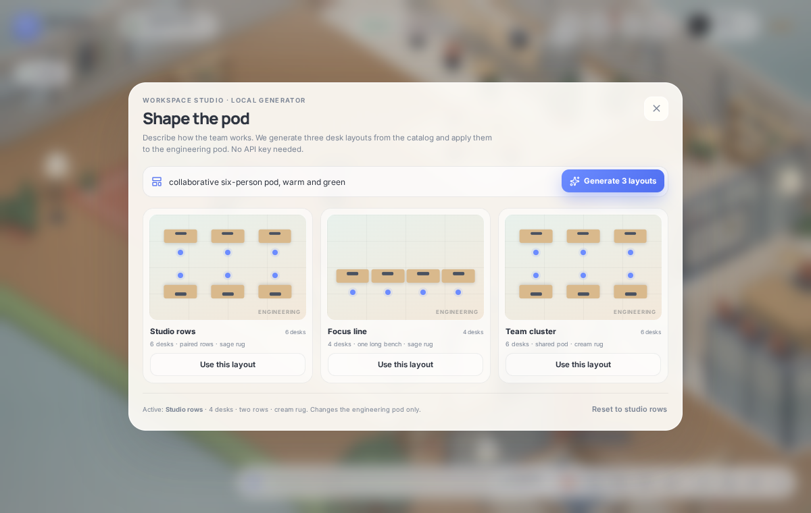

# Workbits

**A browser-based isometric virtual office where remote teams can see each other, walk over, talk by proximity, chat, and work.**

Workbits is built to be a product, not an internal tool: multi-tenant architecture, customizable offices, AI-assisted world-building, and a deployment story that starts with one Node process and scales without a rewrite.


| Avatar Studio | Workspace Studio |
|---|---|
|  |  |

## Status — first playable demo

**Working locally now:**

- Isometric 3D office with lounge, engineering pod, glass meeting room, kitchen, nap room, and garden.
- The Workbits team seed pack: 8 characters (human, frog, crab mascot), name tags, statuses, roles, and desks.
- Click-to-walk and WASD movement with a floating move marker.
- Colyseus realtime presence: two tabs see each other; movement is server-validated.
- Shared text chat: Global, Office, Room, and DM; room chat is scoped to the room you are standing in, DMs are routed server-side to the two participants only, and history persists.
- Local AI assistant: ask where people are, which room is free, who is in the meeting room, or for a summary. Answers come from live presence; no API key, with walk-to actions.
- Proximity voice via LiveKit: server-minted room-scoped tokens, mic publish, distance-based volume, deafen, and a truly separate LiveKit room for the meeting room. Verified with two browser clients and cross-room isolation.
- Avatar Studio: prompt → three modular bases → tune skin, hair, outfit, glasses, beard, cap, and chain → apply and persist; your avatar syncs to everyone in the office.
- Workspace Studio: prompt → three desk layouts → apply to the engineering pod for everyone, and persist.
- Office assistant panel: live presence/room Q&A, scene-aware answers, walk-to actions, and an explicit local-engine label.
- Rooms popover with click-to-walk navigation, invite links with a pick-your-seat onboarding, status menu, animated room-wide emotes, and automatic reconnect.
- Verification scripts: screenshots, headless bot, voice check, avatar studio, proximity math.

**Not done yet:** auth/orgs/invites, a full office editor, a real LLM room generator, billing, landing page, and multi-instance scale. Chat persistence, mobile layout, and a local workspace generator are in.

## Quick start

See [`HANDOFF.md`](HANDOFF.md) for the five-minute tour, what is real, and known gaps.

```bash
bun install
bun run dev
```

`bun run dev` starts the self-hosted LiveKit container (via Docker Compose), the realtime server on `:3101`, and the web app on `:3100`.

### Production (single process)

The same Node process serves the built web app, the Colyseus realtime endpoint, and the LiveKit token API:

```bash
bun run build
bun run start
# http://localhost:3101
```

`bun run prod-check` builds, boots a production server on `:3201`, and verifies static serving, SPA fallback, health, token rejection, hashed assets, same-origin realtime, and a clean browser load.

### Docker

```bash
docker compose -f infra/docker-compose.prod.yml up --build
# http://localhost:3200
```

This starts the app container plus LiveKit. Set `LIVEKIT_URL`, `LIVEKIT_API_KEY`, and `LIVEKIT_API_SECRET` for anything beyond the local dev keys.

Open **http://localhost:3100**. Click the user chip in the top-right to switch demo characters, or open a second tab with:

```
http://localhost:3100/?character=jules
```

Click the mic to publish your microphone. Voice volume follows avatar distance; the meeting-room privacy switch is not wired yet.

## Verification

```bash
bun run verify
```

This runs typecheck, 22 unit tests, proximity math checks, a desktop screenshot, realtime presence/chat tests, voice and private-room isolation checks, reconnect, DM privacy, the assistant, both studios, and mobile. The production mode has a separate `bun run prod-check`. The report and screenshots land in `artifacts/verify/<timestamp>/`. Artifacts are gitignored.

## Stack

| Layer | Choice |
|---|---|
| Client | React 19 + Vite + TypeScript + React Three Fiber + drei |
| Realtime | Colyseus 0.16 (Node + tsx) |
| API | Node HTTP + LiveKit token endpoint |
| Voice | LiveKit (self-hosted dev server; LiveKit Cloud for prod) |
| State | Zustand + server-authoritative presence messages |
| AI | Local avatar/workspace generators + local office assistant; provider adapter pending |
| Runtime | Bun for installs/scripts; Node for Colyseus |
| Deploy | One Node process serving web + realtime + token API; Docker Compose for app + LiveKit |

## Docs map

- [`PLAN.md`](PLAN.md) — product, architecture, phases, risks.
- [`AGENTS.md`](AGENTS.md) — how an agent works in this repo.
- [`docs/brief.md`](docs/brief.md) — the original directives, distilled.
- [`docs/decisions.md`](docs/decisions.md) — ADR log.
- [`docs/open-questions.md`](docs/open-questions.md) — what is still undecided.
- [`docs/progress.md`](docs/progress.md) — phase status and changelog.
- [`docs/backlog.md`](docs/backlog.md) — deliberately deferred ideas.
- [`docs/research/`](docs/research/) — technology, assets, models, pstack.
- [`docs/art/`](docs/art/) — style bible and team cast.
- [`docs/architecture/`](docs/architecture/) — system, data, realtime, voice, chat, AI, security, deployment.
- [`docs/verification/`](docs/verification/) — the harness and phase gates.
- [`docs/operations/`](docs/operations/) — model routing and usage.

## Repo layout

```
apps/web          React + Vite + R3F client
apps/server       Colyseus realtime + LiveKit token endpoint
packages/shared   shared types/schemas
infra             Docker Compose, Caddy, LiveKit, deploy scripts
art               concept references, demo screenshots, exports
seeds/team        optional, data-driven team demo pack
docs              product, architecture, research, verification, progress
```

## Non-negotiables

1. **Place first.** Presence and proximity are the product.
2. **One coherent art direction.** No pixel art, no mixed packs, no AI core geometry.
3. **Evidence, not assertions.** Screenshots, flows, metrics, and a report for every phase.
4. **Simple deployment by default.** One app process, Postgres, LiveKit, Caddy. Redis/S3 optional.
5. **Tenant isolation and authz from day one.**
6. **No copying.** References are direction, not assets, branding, or code.

---

Proprietary. All rights reserved. No license granted yet.
