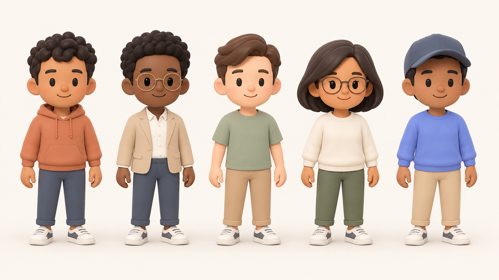
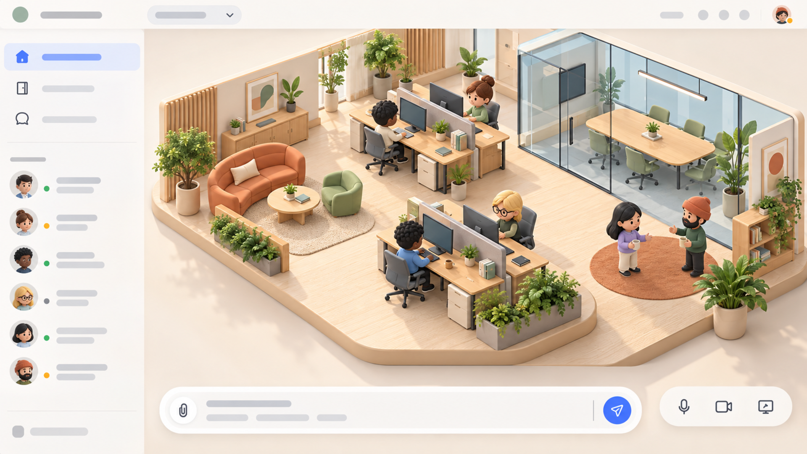

# Art direction — Workbits

**Status:** Approved by the user on 2026-11-02 ("I love the direction").

## North star

A warm, clean, isometric office diorama that looks like a premium product, not a game jam. It should feel like a place you want to spend a workday: soft daylight, plants, wood, glass, pastel color, and charming people.

## Style bible

### Camera

- Orthographic, 45° azimuth, ~30° elevation.
- Fixed orientation; pan and zoom only. No free orbit in v1.
- Cutaway walls: back walls low/faded, front open to the camera.
- The office sits on a floor plate with a soft edge; background is a warm gradient or subtle environment, never a busy scene.

### Palette

| Token | Hex | Use |
|---|---|---|
| Sand | `#F4E9DC` | Floor base, walls |
| Warm white | `#FBF7F1` | Background, highlights |
| Oak | `#D9B98C` | Desks, shelves, frames |
| Terracotta | `#D98E73` | Accent furniture, rugs |
| Sage | `#A8BFA3` | Sofas, plants, soft accents |
| Olive | `#6F8F6A` | Plant depth, secondary |
| Slate | `#5C6B7A` | Textiles, metal, shadows |
| Ink | `#2E3440` | Text, outlines avoided, dark details |
| Glass | `#CFE8EF` | Partitions, windows |
| Accent | `#6C8CFF` | Primary UI actions, selection |

Themes: **Sand** (default), **Sage**, **Slate**, **Dusk**. Themes swap floor/wall/fabric palettes, not the UI accent.

### Materials

- Flat/toon shading with subtle roughness variation.
- No photoreal textures, no grain/noise on every surface, no plastic specular hotspots.
- Soft contact shadows and SSAO; one warm key light, one cool fill.
- Glass is transparent with a subtle tint and edge highlight; not a mirror.
- Plants are stylized: readable leaf clusters, not individual modeled leaves.

### Proportions

- Characters: 1.55–1.7 m, head about 1/3 of total height, short limbs, large hands/feet optional for charm.
- Furniture: rounded 0.1–0.2 m bevels; chunky, readable silhouettes.
- Walls: 2.8 m, cutaway at ~1.1–1.4 m or faded above.
- Grid: 0.5 m placement grid; door widths 1.5 m; desk 1.4 × 0.7 m.

### Characters

- Five consistent body/hair/outfit archetypes minimum, diverse skin tones.
- Simple faces: dot/oval eyes, brows, small smile. No detailed noses or teeth.
- Modular: body, hair, top, bottom, shoes, glasses, accessories; palette-masked.
- Animations: idle (breathing/sway), walk, sit, type, wave, emote. Crossfade 150–250 ms.
- Name tags: small, rounded, high contrast, fade at distance; status dot.
- Voice indicator: soft ring/pulse at the feet, not a giant halo.

### Furniture

- Core kit: desks, monitors, chairs, sofas, coffee tables, shelves, plants, rugs, kitchen counters, glass meeting rooms, doors, whiteboards, lamps.
- Everything re-materialed to the palette; no raw asset-pack textures.
- Props tell a story: mugs, notebooks, laptops, books, a plant, a poster. Sparse, not cluttered.
- Footprints and snap points are data, not guesses.

### UI

- Light glassmorphism, 12–16 px radii, 1 px translucent borders, soft shadows.
- Type: Inter or Geist. 14 px base, 12 px meta, 20–24 px headings.
- Left sidebar: office/floor switcher, roster, rooms, DMs.
- Bottom: chat composer; floating control bar for mic, camera, screen, reactions.
- Accent `#6C8CFF` for primary actions; status colors: green available, amber away, red busy, slate offline.
- No fantasy chrome, no pixel fonts, no heavy gradients.

## What the concept refs get right

- Camera, cutaway, glass room, palette, plants, warm daylight.
- Character charm and consistency (the lineup is the bar).
- Product layout: sidebar, roster, composer, floating controls.

## What to change in-engine

- Flatter color blocking; remove wood grain/foliage texture noise.
- Slightly stronger AO and contact shadows for readability.
- Larger heads / shorter bodies than the scene render.
- Less "Pixar plastic"; more matte, graphic surfaces.
- Lower the back wall so the room reads at a glance.
- Add game cues: name tags, status dots, voice rings, subtle hover/selection.

## Style-frame acceptance criteria (Phase 1)

The first real render is accepted when:

1. It reads as the same world as `art/style-scene.png` at a glance.
2. The palette matches within reason; no off-brand colors.
3. Characters are charming, consistent, and readable at 100% zoom.
4. Walls/furniture do not occlude the player; cutaway works.
5. It holds 60 fps at 1080p on integrated graphics.
6. A side-by-side with the concept shows "same direction, more graphic", not "worse 3D".

## Never

- Pixel art, voxel art, photoreal textures, fantasy chrome.
- Mixed asset packs without re-materialing.
- AI-generated core avatars or structural geometry.
- Copying SoWork/WorkAdventure/WoW assets, UI, or branding.
- Drop shadows that disagree with the light direction.
- Detail that turns to noise at the default zoom.
